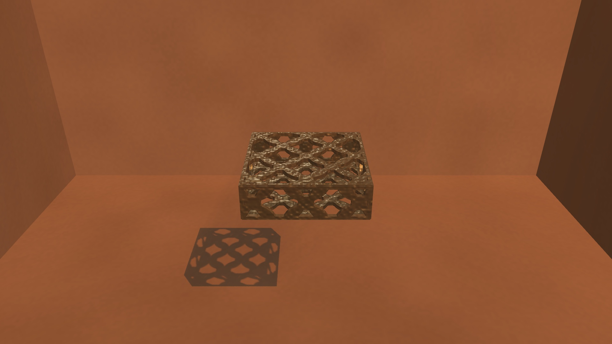
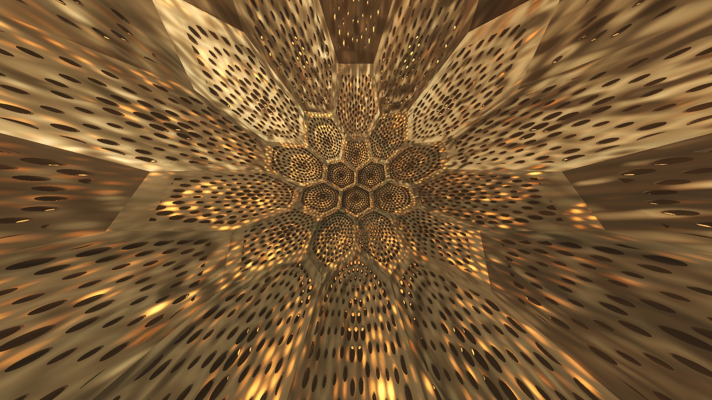
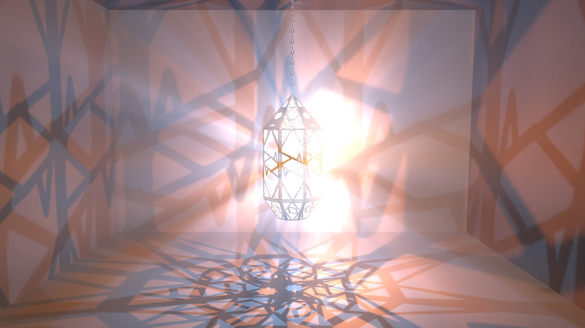
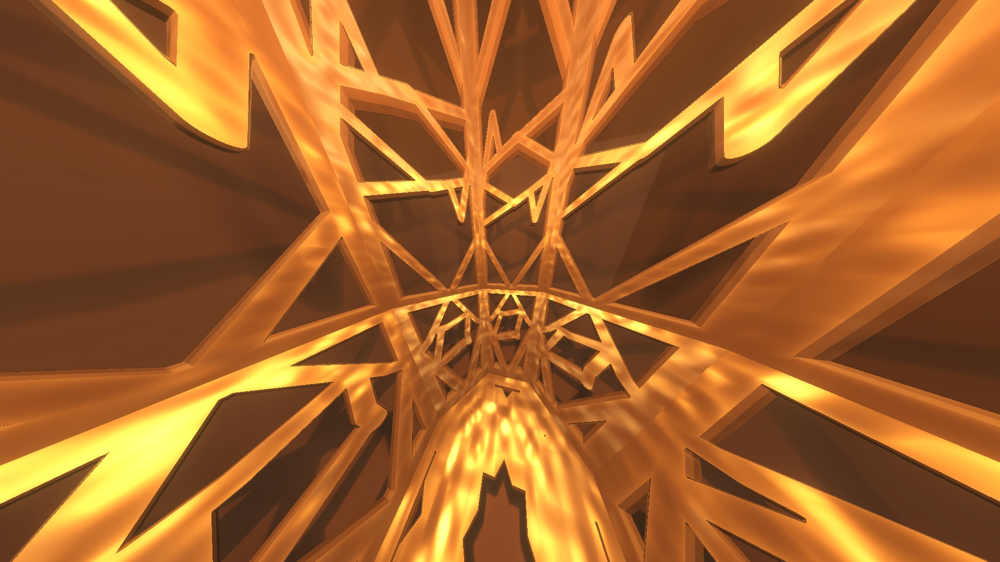
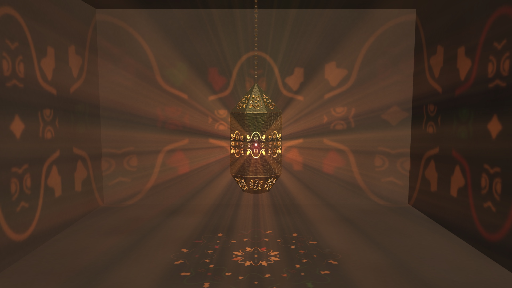

# Fanous — Releases

A pierced lantern with a light inside that throws its pattern onto the room. An FFGL source plugin for
Resolume Arena and Avenue on macOS.

This repository hosts the signed, notarized releases of Fanous. The source code is private.
Bug reports and feature requests are welcome in the [Issues tab](../../issues).

## Download

Latest release: **[Releases page](../../releases/latest)**. Earlier versions are on the [Releases tab](../../releases).

## What it is

*Fanous* (فانوس) is Arabic for lantern. The plugin builds one in 3D and lights it from the inside:

- **The lantern:** 27 polyhedra (Platonic, Archimedean, Catalan, Goldberg, prisms, stars such as the
  Moravian star). You can morph, truncate, bevel and spike them. Or load your own model (.glb / .gltf / .fbx / .obj).
- **The piercing:** 27 patterns cut through every plate. Islamic star patterns (Hankin, girih, khatam,
  mashrabiya, arabesque), Penrose, punched tin, Celtic knots, Voronoi, gyroids and more. Coloured glass can fill the holes.
- **The light:** one or two lights, inside the lantern, outside it, or as a sun. Each throws the pattern
  onto the floor, the walls, the ceiling and the lantern's own inner plates. The pattern is sharp close up and soft
  far away, like a real bulb. Haze and smoke show it as beams.
- **The room:** plaster, concrete, zellige tiles or wood. *Light Only* mode gives you just the thrown light
  on transparent black, to lay over your other layers.
- **Motion and show control:** spin, swing on its chain, bob, beat-synced pulses and cuts, camera poses, a camera
  inside the lantern. Optional smoke, fire, lightning, fireflies and post effects.

| | |
|---|---|
|  |  |
|  |  |

## Requirements

- macOS 11 (Big Sur) or later, Apple Silicon or Intel (universal plugin)
- Resolume Arena or Avenue 7 or later (tested with Arena 7.28.0 on macOS 26)
- A GPU that runs Resolume 7 comfortably. Fanous renders a full 3D scene with volumetric light

## Installing

1. Download `Fanous-<version>-macOS.zip` from the [latest release](../../releases/latest) and double-click it.
2. Quit Resolume.
3. Copy `Fanous.bundle` into the **Extra Effects** folder:
   - Arena: `~/Documents/Resolume Arena/Extra Effects/`
   - Avenue: `~/Documents/Resolume Avenue/Extra Effects/`

   In Finder: **Go ▸ Home**, then **Documents ▸ Resolume Arena ▸ Extra Effects**.
4. Start Resolume. Find **Fanous** under **Sources** and drag it onto a clip slot.

Fanous is signed and notarized by Apple, so macOS loads it without a security prompt.

**Updating:** quit Resolume, then replace the old `Fanous.bundle` with the new one. A plugin that Resolume has
already loaded stays in memory until Resolume restarts.

## Where your work is saved

- Every Fanous dial is saved in the clip, inside your Resolume composition (`~/Documents/Resolume Arena/Compositions/`).
  Save the composition to keep your looks.
- A model you load is saved as a **path**, so keep the file where it is. Put your models in
  `~/Documents/Resolume Arena/Fanous Library/` (one folder per model) and they appear in the **Library** list.

## First look: what to try

1. **Solid** and **Pattern A.** Change the lantern's shape and the cut. The thrown light follows straight away.
2. **Haze** (Volume) up to about 0.1. The beams appear.
3. **L1 Type ▸ Sun.** Sunlight falls through the lantern; set **L1 Sun Elevation** to taste.
4. **Camera View ▸ Inside The Lantern** with **FOV** around 100. You are standing in the pattern.
5. **Glass Fill** to 0.3–1. Coloured glass fills the holes and throws coloured light.
6. **L2 Enable** and an **L1 Orbit** / **L2 Orbit** speed. Two moving lights cross their patterns.
7. **Room Mode ▸ Light Only.** Only the thrown light remains, ready to layer over video.
8. **Solid Morph**, **Truncate** or **Swing**. They animate well: put a Resolume dashboard dial or an LFO on them.

## Reporting issues

Please open an [Issue](../../issues) with:

- Your macOS version (`sw_vers`) and Mac model
- Your Resolume version and Fanous version (the **Status** line at the top of the Source group shows it)
- The steps that cause the problem, plus a screenshot or recording if it is visual
- If you can: turn on **Debug Log** (the last parameter), reproduce the problem, and attach
  `~/Library/Logs/Fanous/Fanous.log`

## Verifying the download

Each release includes a `.sha256` file. To check the zip:

    shasum -a 256 Fanous-<version>-macOS.zip

## License

You may use Fanous in your performances and productions; see [LICENSE.txt](LICENSE.txt). Fanous includes
open-source components; see [THIRD-PARTY-NOTICES.txt](THIRD-PARTY-NOTICES.txt).

© 2026 Amrit Rosell
